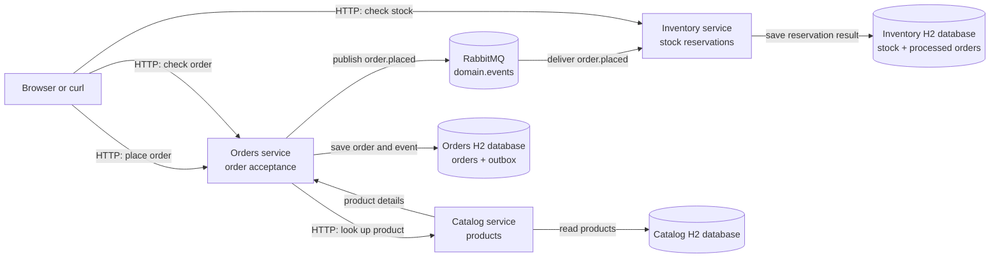

# How the Store Microservices Application Works

This guide follows one order through the application and points out where each microservices concept appears. You can run the application with Docker Compose; see the [main README](../README.md) for setup details.

## The big picture



Each service owns its own application code and database. The arrows between services are APIs or messages; one service never queries another service's database.

## Follow one order

Suppose a customer wants to order two Coffees. The seeded Catalog product ID for Coffee is `1`.

### 1. The client sends an order request

Run the services, then submit this request from another terminal:

```sh
curl -i -X POST http://localhost:8002/orders \
  -H 'Content-Type: application/json' \
  -d '{"product_id":1,"quantity":2}'
```

The client talks to the **Orders service**. It does not contact the database or RabbitMQ directly.

### 2. Orders checks the product synchronously

Before accepting the order, Orders calls Catalog over HTTP:

```text
Orders ── GET /products/1 ──▶ Catalog
Orders ◀── Coffee, price ──── Catalog
```

This is **synchronous communication**: Orders waits for Catalog's response before continuing. If the product does not exist, Orders rejects the request. If Catalog cannot be reached, Orders returns an error instead of accepting an order it could not validate.

### 3. Orders saves the order and an event together

After Catalog confirms the product, Orders creates an order ID and writes two records to its **own database** in one transaction:

- The order, initially marked `accepted`.
- An outbox entry containing an `order.placed` event.

The outbox makes sure the event is not lost if Orders saves the order but RabbitMQ is temporarily unavailable. The event contains the order ID, product ID, and quantity; it does not expose or share the Orders database.

Orders responds to the client with `201 Created` and the accepted order. At this point, the Inventory service may not have processed it yet.

### 4. Orders publishes the event asynchronously

A background publisher checks Orders' outbox and sends pending events to RabbitMQ. The event uses the routing key `order.placed` on the `domain.events` exchange:

```text
Orders outbox ── order.placed ──▶ RabbitMQ
```

This is **asynchronous communication**: the request handler has already responded, so the client does not wait for Inventory. If publishing fails, the outbox entry remains pending for another attempt.

### 5. Inventory consumes the event

Inventory listens to its RabbitMQ queue and handles the event independently:

1. It checks its own database for the order ID. If it has already processed that order, it returns the recorded result without reserving stock again.
2. It checks whether enough stock exists for the product.
3. If stock is available, it reduces the quantity and records the result as `reserved`.
4. If stock is insufficient, it records the result as `rejected` and leaves stock unchanged.

The stock update and processed-order record are saved in Inventory's database. Inventory does not call Orders or read Orders' data.

### 6. The client checks the result

Use the ID from the `POST` response to inspect the accepted order:

```sh
curl http://localhost:8002/orders/<order-id>
```

Check Inventory to see current stock and the separate reservation result:

```sh
curl http://localhost:8003/inventory
```

The order record remains `accepted`; inventory reservation status is reported by the Inventory service. Since processing is asynchronous, wait briefly and retry the Inventory request if the processed order does not appear immediately.

## Where the microservices concepts appear

| Concept | In this application |
| --- | --- |
| **Service boundaries** | Catalog owns products, Orders owns accepted orders and its outbox, and Inventory owns stock and reservation results. |
| **Database per service** | Each service has a separate file-based H2 database and Docker volume. Services access their own data through their own repositories. |
| **Synchronous communication** | Orders calls Catalog's HTTP API and waits for product details before accepting an order. |
| **Asynchronous communication** | Orders publishes `order.placed` through RabbitMQ; Inventory processes it separately after the HTTP response. |
| **Loose coupling** | Inventory depends on the JSON event contract, not on the Orders API or database. Catalog does not need to know about Inventory. |

## Services and local URLs

| Service | Local URL | Owns |
| --- | --- | --- |
| Catalog | `http://localhost:8001` | Product details |
| Orders | `http://localhost:8002` | Orders and event outbox |
| Inventory | `http://localhost:8003` | Stock and processed-order results |
| RabbitMQ management UI | `http://localhost:15672` | Message broker (`app` / `app`) |

To stop the application, press **Ctrl+C** in the terminal running `docker compose up`.
